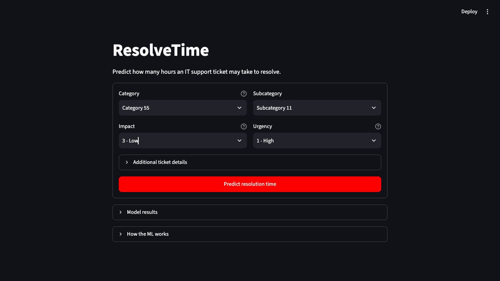

# ResolveTime — IT Support Ticket Resolution Forecasting

A machine learning mini project that estimates elapsed hours from IT ticket opening to final observed resolution. It compares Multiple Linear Regression, k-NN regression, and Gradient Boosting, then serves the selected model through a simple Streamlit interface.

Built for Assignment 10 of the 2026–27 Machine Learning Laboratory manual, covering preprocessing, feature engineering, model building, evaluation, and ensemble methods.

> **Current status:** Educational prototype. The recorded model does not outperform the median baseline on test MAE. Measurements and limitations are reported below; this is not an operational resolution-time guarantee.



## Features

- One ticket form with category, subcategory, impact, and urgency.
- Optional reporting method, date, and time.
- Predicted duration in hours and an estimated calendar time.
- Shared training and inference preprocessing pipeline.
- Chronological evaluation with incident separation and label-availability checks.
- Grid search with expanding temporal cross-validation.
- A median baseline and clearly reported MAE, RMSE, and R².
- Presentation guide, unit tests, and a GitHub Actions test workflow.

## Quick start

Use **Python 3.11**. The recorded package environment is provided in `requirements-lock.txt`; `requirements.txt` contains broader compatibility ranges.

```bash
git clone https://github.com/Sohampatil00/resolvetime-ml.git
cd resolvetime-ml
python3.11 -m venv .venv
source .venv/bin/activate
python -m pip install -r requirements-lock.txt
python download_data.py
python -m unittest discover -s tests -v
python train.py
python -m streamlit run app.py --server.port 8502
```

Open **[http://localhost:8502](http://localhost:8502)**. Stop the server with **Ctrl+C**.

If `python3.11` is unavailable, use an installed Python 3.11+ interpreter in the environment-creation command. On Windows, use `py -3.11 -m venv .venv` and activate with `.venv\Scripts\Activate.ps1`.

The first download requires internet. Training runs locally on CPU. Raw data and the trained model are generated locally and excluded from Git. Do not skip training on a fresh clone. To replace an existing model intentionally:

```bash
python train.py --overwrite
```

If downloading manually, get the ZIP from the UCI page, extract `incident_event_log.csv`, and place it at `data/raw/incident_event_log.csv`. Alternatively:

```bash
python train.py --data "/path/to/incident_event_log.csv"
```

## Dataset

[UCI Incident Management Process Enriched Event Log](https://archive.ics.uci.edu/dataset/498/incident+management+process+enriched+event+log), by Claudio Amaral, Marcelo Fantinato, and Sarajane Peres (2018), DOI [10.24432/C57S4H](https://doi.org/10.24432/C57S4H), licensed CC BY 4.0.

The source reports 141,712 events covering 24,918 incidents from an IT company's ServiceNow system. Multiple events belong to one incident; **141,712 events are not 141,712 independent tickets**. The log contains unknown values, anonymized category codes, and no free-text problem descriptions. We cannot infer which category means “network” or “login,” so the app shows original codes.

The downloader records the source URL, timestamp, and SHA-256 hashes alongside the downloaded CSV. It only writes the expected CSV from the ZIP rather than extracting arbitrary paths.

## Recorded results

The reference run is preserved in [docs/evaluation.json](docs/evaluation.json). These are saved measurements, not new results generated when viewing this README.

| Model | Validation MAE, hours |
| --- | ---: |
| k-NN Regression | 126.36 |
| Median baseline | 126.38 |
| Gradient Boosting | 137.19 |
| Linear Regression | 2,566.95 |

Selected configuration: **k-NN with 15 neighbors and uniform weights**, using three temporal cross-validation folds.

| Final test measurement | Selected k-NN | Median baseline |
| --- | ---: | ---: |
| MAE, hours | 147.69 | **144.95** |
| RMSE, hours | **269.76** | 272.70 |
| R² | -0.260 | -0.287 |
| Test incidents | 154 | 154 |

The k-NN validation advantage is very small and does not carry over to test MAE. Negative R² and large errors show that generalization needs improvement. No classification accuracy percentage is claimed for this regression task.

The run contains **22,968 initial training**, **61 validation**, and **154 test** tickets. Final refit uses **23,176 eligible pre-test** tickets. Boundaries use percentages of unique opening days, not ticket rows. Uneven arrivals and label-availability exclusions produce highly unequal groups; final refit is not a fourth disjoint holdout.

## Syllabus mapping

| Manual topic | Implementation |
| --- | --- |
| Assignment 2: Multiple Linear Regression | `LinearRegression` with multiple encoded and engineered predictors |
| Assignment 5: k-NN regression | Neighbor-based estimates; tune neighbor count and weighting |
| Assignment 9: Gradient Boosting | scikit-learn's histogram-based implementation of Gradient Boosting |
| Assignment 10: Preprocessing | Validate dates, handle unknown categories, encode categorical inputs, scale numerical features |
| Assignment 10: Feature engineering/selection | Cyclic hour/weekday/month, weekend flag, impact–urgency interaction, explicit input selection, remove constant encoded features |
| Assignment 10: Model building/evaluation | Compare three regressors and a median baseline using MAE, RMSE, median absolute error, and R² |
| Assignment 10: Advanced methods | Boosting ensemble, grid search, expanding temporal cross-validation |
| Assignment 10: Presentation/deployment | Streamlit UI, saved model, evaluation reports, and GitHub source |

Python, NumPy, pandas, and scikit-learn implement the ML workflow. Streamlit provides the interface; joblib stores the trained pipeline. HMM, clustering, and reinforcement learning are not added because this is a supervised regression problem. Accuracy, F1, and classification AUC are not appropriate metrics for an hours-valued target.

## Target and initial snapshots

```text
resolution_hours = (latest valid resolved_at − initial opened_at) / 3600 seconds
```

- Use only rows with `sys_mod_count == 0` to obtain genuine initial captured versions. Tickets without such a row are excluded and counted.
- If more than one initial-version row is present, select the earliest `sys_updated_at`, with source order breaking ties. Preserve missing initial fields instead of filling them from future events.
- Use the latest valid `resolved_at` for each incident as its outcome, covering final observed resolution after reopening. `closed_at` is not the target because administrative closure can occur after resolution.
- Exclude missing opening dates, unknown resolution outcomes, and negative durations. Retain valid zero-hour cases and long durations; no target clipping or outlier removal improves the reported metrics artificially.
- Use elapsed clock hours, including nights and weekends. These are not business hours or SLA guarantees.

## Inputs and leakage prevention

The only raw predictor fields are:

```text
opened_at, category, subcategory, contact_type, impact, urgency
```

Identifiers, written descriptions, final reassignment/reopen counts, `resolved_at`, `closed_at`, `made_sla`, and resolution codes are never model inputs. Some excluded fields are known only later; others are unnecessary for this opening-time task.

The source does not document a timezone. All dates are parsed consistently without timezone conversion. Data processing accepts ISO timestamps or UCI's day/month/year convention. The prediction form supplies an ISO timestamp. Timezone-aware inputs are rejected rather than silently converted.

Unknown categorical inputs are retained as `__unknown__`. Training-only one-hot encoding groups infrequent levels and limits cardinality. Unseen prediction values are handled without refitting, and the result is marked for cautious interpretation. Scaling, encoding, and constant-feature removal are fitted separately inside every training fold.

All three learned models train on `log1p(hours)` to reduce the influence of long durations. Their outputs are converted back to hours; negative outputs are floored at zero. Selection and evaluation use errors in hours, not log space. The median baseline uses original hours.

## Evaluation design

1. Order incidents by opening day; set boundaries at 60% and 80% of the unique opening days. Entire days and incidents stay together.
2. Initial training contains earlier incidents whose final observed resolution is known before validation starts.
3. Validation contains middle-period incidents whose final observed resolution is known before test starts.
4. Inside training, grid search uses expanding temporal folds. Each fold's training labels must be known before that fold's validation period. Validation-fold outcomes must be known before its end.
5. Select the model with the lowest outer-validation MAE. The median baseline can win; the app does not force a learned model to appear successful.
6. Refit the winner on all pre-test incidents with outcomes known before the test cutoff. This can include older incidents that had not resolved at the earlier validation cutoff.
7. Evaluate that final model and a refitted median baseline on the later test population. Test results do not select the model or its parameters.

Reports expose exclusions, cutoffs, model parameters, package versions, and the dataset fingerprint. The exact retained count and actual metrics are calculated only when you run training. No accuracy or improvement is claimed in advance.

**Limitations:** Excluding unresolved cases creates selection bias, especially for very long incidents. Restricting outcomes to those known by a time cutoff also changes the evaluation population. This is an observed-resolution regression project, not a survival-analysis system. The source comes from one historical organization; results do not establish performance for today's tickets or other companies. The first captured version may occur after the user-reported opening time. Apparent effects of urgency or impact are associations, not proof that changing them changes resolution time.

## Interface

The app uses one centered screen. Select category, subcategory, impact, and urgency, then click **Predict resolution time**. Contact method, reporting date, and reporting time are under **Additional ticket details**. The result shows estimated hours and a calendar time. Changing an input clears the old result.

Supporting material stays inside two collapsed sections:

- **Model results:** Selected model, test MAE/RMSE/R², median baseline comparison, and a compact validation table.
- **How the ML works:** Features, target, preprocessing, models, tuning, actual split counts, source, and limitations.

The UI requires a real trained artifact and does not manufacture demo predictions. Detailed evaluation files remain available for review.

See [PRESENTATION_GUIDE.md](PRESENTATION_GUIDE.md) for exact demo inputs, a speaking script, syllabus mapping, saved metrics, and viva answers. Update the guide's saved-run numbers after retraining.

## Files and outputs

```text
app.py                         Streamlit interface
PRESENTATION_GUIDE.md           Demo order, ML terms, saved results, viva answers
download_data.py               Official UCI CSV downloader
train.py                       Preparation, tuning, selection, final evaluation
resolvetime/data.py            Snapshots, date parsing, features, chronological splits
resolvetime/modeling.py        Preprocessing, estimators, shared inference
tests/                         Leakage, dates, schema, and pipeline persistence checks
requirements.txt               Lightweight standalone dependencies
requirements-lock.txt          Recorded installed package versions
CONTRIBUTING.md                Contribution and validation guidance
docs/interface.png             Interface screenshot
docs/evaluation.json           Aggregate reference-run measurements
docs/PUBLISHING.md              Initial GitHub publishing instructions
.github/workflows/tests.yml     Automated unit-test workflow
data/raw/incident_event_log.csv Dataset, created by downloader
models/resolution_model.joblib  Pipeline and metadata, created by training
results/metrics.json            Cleaning, comparisons, holdouts, limitations, versions
results/test_predictions.csv    Actual and predicted hours for held-out incidents
results/validation_comparison.csv
results/historical_categories.csv
```

Use the same environment for training and inference; the app checks the saved scikit-learn version. Only load your own trusted joblib artifact. The recorded model environment uses Python **3.11.17**, NumPy **2.4.6**, pandas **3.1.0**, scikit-learn **1.9.1**, and joblib **1.6.0**.

`requirements-lock.txt` captures installed versions read from the existing environment without reinstalling it during repository preparation. It is an environment snapshot, not a hash-locked cross-platform build guarantee. Use `requirements.txt` if compatible version ranges are preferable, and retrain in that environment.

## Checks to run

```bash
python -m unittest discover -s tests -v
python -m pip check
```

Tests cover preserving initial missing fields, reopened outcomes, invalid/unresolved exclusions, mixed supported date formats, preventing future columns from affecting features, temporal label cutoffs, incident separation, persisted-pipeline prediction, unseen categories, and schema mismatch.

The [Tests workflow](.github/workflows/tests.yml) runs on pushes and pull requests. It installs dependencies and runs unit tests without downloading the dataset or retraining. A workflow file is not evidence of a passing run; inspect **Actions** on GitHub for its actual status.

## Reproduction and next steps

Retraining writes fresh local reports under `results/`; it does not automatically update the committed reference snapshot or presentation guide. Keep the dataset fingerprint, package versions, and temporal cutoffs alongside any new measurements.

Next work should investigate the temporal distribution and poor generalization, improve opening-time predictors, and evaluate changes on an independent future holdout. Once the current test set informs changes, it must not be treated as a fresh unbiased final evaluation.

For a presentation, see [PRESENTATION_GUIDE.md](PRESENTATION_GUIDE.md). For contributions and reproducible bug reports, see [CONTRIBUTING.md](CONTRIBUTING.md). Initial repository upload instructions are in [docs/PUBLISHING.md](docs/PUBLISHING.md).

## Attribution and licensing

Dataset: Amaral, C., Fantinato, M., and Peres, S. (2018). *Incident Management Process Enriched Event Log*. UCI Machine Learning Repository. [DOI: 10.24432/C57S4H](https://doi.org/10.24432/C57S4H). Dataset license: **CC BY 4.0**.

A source-code license has not yet been selected. Third-party libraries retain their respective licenses.
